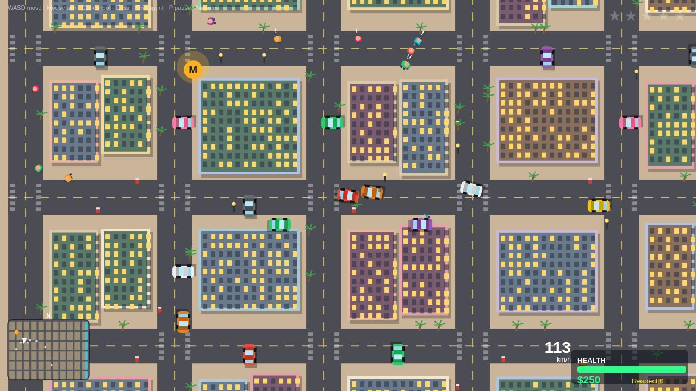
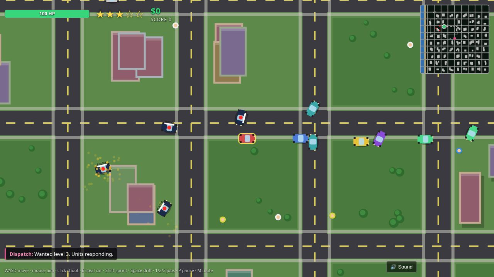
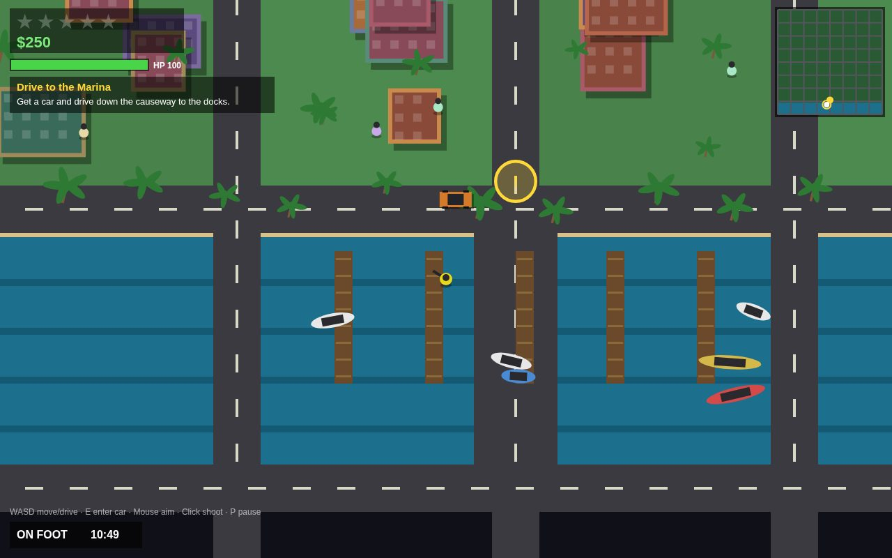

# Marina Heat

An original open-world crime game set in **Coral Marina**, a sun-soaked
3200×3200 coastal city generated procedurally from a seed: a grid of
streets and city blocks, palm trees, and a marina with docks and water
along the east and south edges. Built with vanilla JavaScript and
Canvas 2D — no dependencies, no build step, runs fully offline from
static files.

Steal cars, outrun the Coral Marina PD, and run jobs for fixer
**Marisol Vega**.

[](https://make.fun/bounty/gta6-01?utm_source=github&utm_medium=readme&utm_campaign=gta6-01)
[](https://make.fun/bounty/gta6-01/leaderboard?utm_source=github&utm_medium=readme&utm_campaign=gta6-01)
[](https://make.fun/bounty/gta6-01?utm_source=github&utm_medium=readme&utm_campaign=gta6-01)

Referral: https://make.fun/r/8tpwxchz

## Screenshots

| Cover | Driving |
| --- | --- |
|  |  |

| Police chase | Mission |
| --- | --- |
|  |  |

## Controls

| Input | Action |
| --- | --- |
| WASD / Arrow keys | Move on foot / drive |
| Shift | Sprint |
| Mouse | Aim |
| Mouse click / hold | Shoot (hitscan pistol) |
| E | Steal / enter car, exit car |
| Space | Handbrake (drift) |
| F | Accept a mission offer |
| P / Esc | Pause |
| M | Mute / unmute sound |
| Enter | Start / continue / restart |

## Systems

- **Open world** — seeded procedural city: street grid, blocks,
  buildings with collision, palms, lamps, plazas, beach and marina
  docks.
- **On foot** — WASD movement with sprint and mouse aim.
- **Combat** — hitscan shooting with muzzle flash, tracers and hit
  sparks; damage to cars and pedestrians feeds a chaos score.
- **Vehicles** — steal any parked or traffic car; arcade driving with
  drift on the handbrake; damage states from dented to smoking,
  burning and wrecked, with smoke/fire particles.
- **Traffic AI** — lane-following cars that stop for obstacles, swerve
  around pedestrians, honk, and respawn near the player.
- **Pedestrians** — wander the sidewalks and flee gunfire, explosions
  and fast cars.
- **Wanted system** — crimes raise heat across 1–5 stars; heat decays
  while out of police sight; a BUSTED meter fills when officers are
  close and you are slow or on foot.
- **Police** — cruisers spawn in response to your stars, chase and ram,
  with flashing light bars and sirens.
- **Missions** — three jobs from Marisol Vega with phone-style message
  popups: *Bay Run* (timed checkpoint run), *Special Delivery* (drive a
  package car to the drop-off while wanted) and *Rampage* (score 1500
  chaos points against the clock).
- **HUD & minimap** — health, cash, wanted stars, chaos, car status,
  mission objective, phone messages, and a live corner minimap with
  player, car, police and mission markers.
- **Sound** — WebAudio-synthesized gunshots, impacts, engine, sirens,
  pickups and jingles. No audio files.
- **Save** — cash and mission progress persist in `localStorage`;
  Continue from the title screen.
- **Screens** — title, pause, WASTED (health reaches zero) and BUSTED
  (meter fills), plus mission complete/fail banners.
- **Deterministic screenshots** — `game/index.html?shot=<cover|drive|chase|mission>&seed=<n>`
  poses a frozen scene and sets `window.__shotReady` when rendered.

## Run it

```sh
node serve.ts            # serves game/ on http://localhost:8080
```

Or serve the `game/` directory with any static file server and open
`index.html`. To hand the entry in (copies `game/` + `screenshots/` and
writes `dossier.json`):

```sh
MAKEFUN_OUTPUT_DIR=out node main.ts
```

## License

MIT — see [LICENSE](LICENSE).
