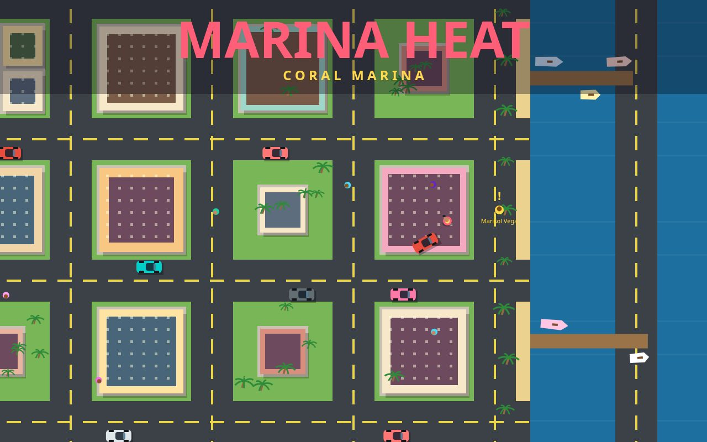

# Marina Heat

[](https://make.fun/bounty/gta6-01?utm_source=github&utm_medium=readme&utm_campaign=gta6-01)
[](https://make.fun/bounty/gta6-01/leaderboard?utm_source=github&utm_medium=readme&utm_campaign=gta6-01)
[](https://make.fun/bounty/gta6-01?utm_source=github&utm_medium=readme&utm_campaign=gta6-01)

**Marina Heat** is a top-down 2D open-world crime game set in Coral Marina, a
sun-drenched coastal city of palm-lined streets, neon storefronts and a working
marina. Steal cars, run jobs for fixer Marisol Vega, outrun the Coral Marina PD
wanted-level chase system, and build your reputation — all in vanilla
JavaScript on a single Canvas 2D surface. No dependencies, no build step, fully
offline.

The city is procedurally generated from a seed (default 7): a 3200×3200 world
with a street grid, city blocks with varied buildings, palm trees, sidewalks,
and water with docks and moored boats along the east and south edges.

## Screenshots

| Cover | Driving |
| --- | --- |
|  |  |

| Police chase | Mission |
| --- | --- |
|  |  |

## How to run

- **Just play:** open `game/index.html` in any modern browser. Everything is
  static and offline; there is nothing to install.
- **Local server:** `node serve.ts` (from the repo root) serves the game at
  http://127.0.0.1:8917/ — handy because some browsers restrict ES modules on
  `file://` URLs.
- **Programmatic harness:** `node main.ts` copies the game and screenshots
  into `$MAKEFUN_OUTPUT_DIR` (or `./output`) together with a `dossier.json`
  describing the entry.

## Controls

| Input | Action |
| --- | --- |
| Enter | Start game / confirm |
| W A S D / Arrow keys | Move on foot, drive |
| Mouse | Aim |
| Mouse button (hold) | Shoot |
| E | Enter / exit the nearest car |
| Shift | Sprint on foot / handbrake boost feel in a car |
| P | Pause / resume |
| M | Toggle sound |

## Gameplay

- **Open world:** pedestrians stroll the sidewalks, traffic flows along the
  street grid and stops at junctions; every parked or moving car can be
  stolen.
- **Wanted system:** crimes (car theft, assault, shots fired, collisions)
  raise your wanted level from 1 to 5 stars. Police cruisers spawn, pursue,
  ram and shoot; break line of sight and stay clean to cool down.
- **Combat:** aim with the mouse, hold to fire. Health, armor of the moment,
  and a busted/wasted flow when the law or your wounds catch up with you.
- **Missions:** fixer **Marisol Vega** (marked on the minimap) offers jobs —
  deliveries, pickups, and the timed **Bay Run** checkpoint race around the
  marina. Completing missions pays cash and raises your reputation.
- **HUD & minimap:** cash, reputation, health, wanted stars, mission text and
  a live minimap with player, police, traffic and objective markers.
- **Audio:** a small WebAudio synth provides engine hum, sirens, gunshots,
  pickups and UI blips — no audio files needed.
- **Save:** cash, reputation, completed missions and settings persist in
  `localStorage`.

## Deterministic screenshots

The game supports staged screenshot modes for reproducible captures:

`game/index.html?shot=cover|drive|chase|mission&seed=7`

Each mode builds the seeded city, poses a scene (cover tableau, driving,
police chase, mission briefing), renders one frame, and sets
`window.__shotReady = true` when the frame is ready to capture. See
`shots.json` for the capture list (1280×800).

## Layout

```
game/index.html        entry page (canvas #game)
game/style.css         page styling
game/src/*.js          engine modules: rng, city, input, storage, audio,
                       vehicles, traffic, pedestrians, player, police,
                       combat, missions, hud, minimap, shots, main
main.ts                make.fun harness (copies entry + dossier to output)
serve.ts               tiny static server for local play
shots.json             screenshot capture manifest
screenshots/           the four staged captures
```

Referral: https://make.fun/r/8tpwxchz

## License

MIT — see [LICENSE](LICENSE).
